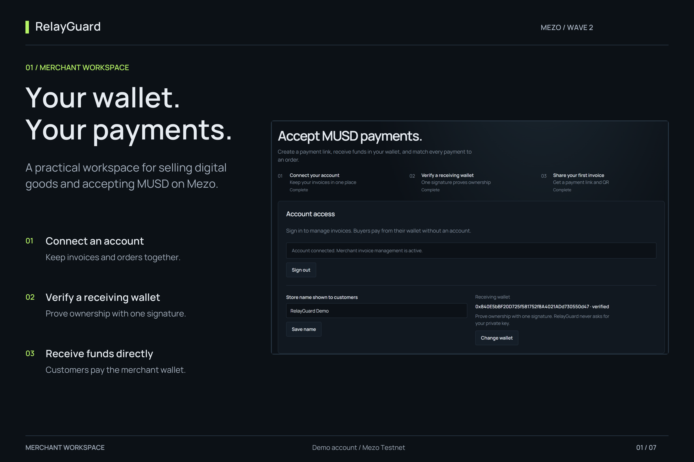
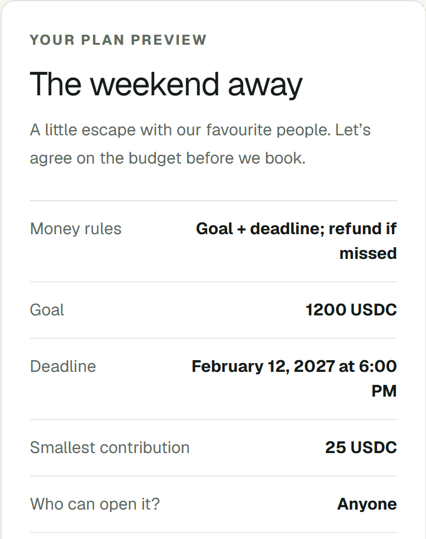
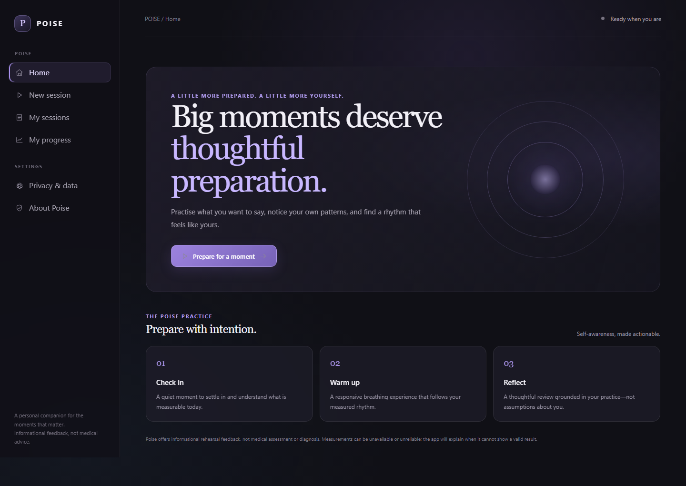
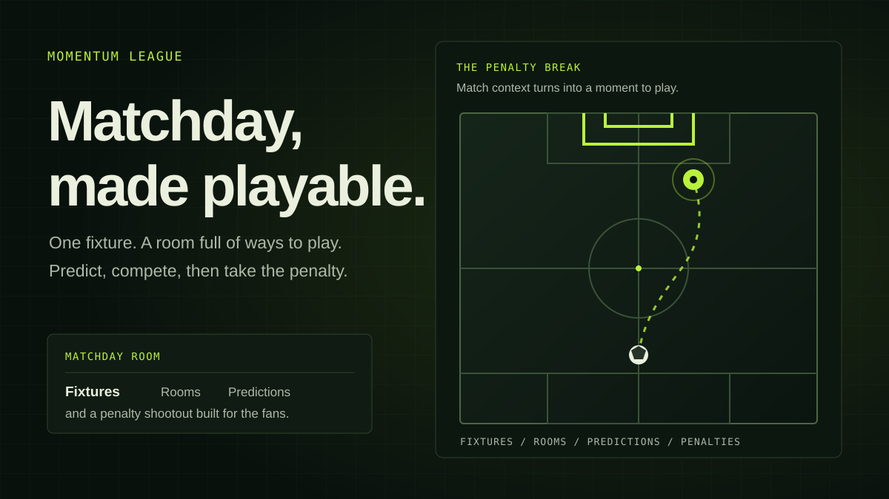

  

  <a href="https://github.com/Reinasboo">GitHub</a>
  &nbsp;&nbsp;·&nbsp;&nbsp;
  <a href="https://x.com/sharpmetaa">X</a>
  &nbsp;&nbsp;·&nbsp;&nbsp;
  <a href="https://x.com/sharpmetaa">Open to work & collaborations</a>

I’m **Spectrolite** — a product-focused software engineer with **4 years of
experience** building across onchain finance, AI, market infrastructure, and
consumer products. I enjoy owning the whole problem, from system architecture
and risk controls to the details people interact with.

## Selected work

<table>
  <tr>
    <td width="50%" valign="top">
      
      <h3><a href="https://github.com/Reinasboo/catalyst">Catalyst</a></h3>
      
Find promising open-source projects before they become obvious. Catalyst weighs repository momentum, project quality, technical narratives, and builder history—and shows the evidence behind the signal.

      
<a href="https://github.com/Reinasboo/catalyst">Explore the source</a>

    </td>
    <td width="50%" valign="top">
      
      <h3><a href="https://github.com/Reinasboo/relayguard">RelayGuard</a></h3>
      
Payment infrastructure for merchants and software agents. Spending policies, human review, x402 payments, and settlement evidence bring control and accountability to stablecoin flows.

      
<a href="https://github.com/Reinasboo/relayguard">Explore the source</a>

    </td>
  </tr>
  <tr>
    <td width="50%" valign="top">
      
      <h3><a href="https://potonbase.vercel.app">POT</a></h3>
      
Group payments for trips, gifts, and shared goals. People agree on the goal, deadline, and refund rules up front—so everyone knows what they’re contributing to.

      
<a href="https://github.com/Reinasboo/pot">Explore the source</a>

    </td>
    <td width="50%" valign="top">
      
      <h3><a href="https://github.com/Reinasboo/poise">Poise</a></h3>
      
A private rehearsal companion for interviews, presentations, and speaking on camera. Camera-optional practice, local-first history, and grounded feedback put the person—not a score—at the center.

      
<a href="https://github.com/Reinasboo/poise">Explore the source</a>

    </td>
  </tr>
</table>

## More from the portfolio

<table>
  <tr>
    <td width="50%" valign="top">
      
      <h3><a href="https://github.com/Reinasboo/goalproof">GoalProof</a></h3>
      
Verifiable prediction markets on Solana. TxLINE fixture context, Anchor escrow, keeper settlement, and proof receipts connect each market to a clear resolution path.

    </td>
    <td width="50%" valign="top">
      
      <h3><a href="https://github.com/Reinasboo/momentum-league">Momentum League</a></h3>
      
A football matchday product with fixture-based fan rooms, predictions, standings, and a penalty-shootout game. Built with React, Vite, Express, and Solana sign-in.

    </td>
  </tr>
</table>

**Markets and onchain systems**

- **[Sentra Terminal](https://github.com/Reinasboo/sentra-terminal)** — Solana perpetuals analytics, market signals, and trader-focused research.
- **[Oracle Percolator](https://github.com/Reinasboo/oracle-percolator)** — multi-asset oracle intelligence with confidence, latency, spread, deviation, and anomaly telemetry.
- **[Smart Trader](https://github.com/Reinasboo/smart-trader)** — strategy-driven Solana market scanning and execution with explicit risk controls.
- **[TraderLite](https://github.com/Reinasboo/traderlite)** — Telegram-sourced trade monitoring, duplicate-buy safeguards, execution tracking, and a read-only PnL dashboard.
- **[Agentic Wallet](https://github.com/Reinasboo/Agentic-wallet)** — intent-driven wallet orchestration and multi-agent coordination on Solana.
- **[Spectrolite trading systems](https://github.com/Reinasboo/Spectrolite)** — market signals, analysis, and automated execution across Solana and EVM.
- **[Flash](https://github.com/Reinasboo/Flash)** — an agent wallet built for the Stellar ecosystem.

**Consumer products, community, and tools**

- **[HELD](https://heldevents.vercel.app)** — event reservations with refundable commitments, organizer check-in, and Solana escrow. <a href="https://github.com/Reinasboo/held">Source</a>
- **[Chorus](https://github.com/Reinasboo/chorus)** — collaborative finance and AI-assisted planning with human-controlled approvals.
- **[HolderProof](https://github.com/Reinasboo/holderproof)** — read-only wallet monitoring with a queue-backed event pipeline.
- **[Attention Market](https://github.com/Reinasboo/attention-market)** — transparent, deterministic scoring for emerging crypto narratives.
- **[DietMonitor](https://github.com/Reinasboo/dietmonitor)** — meal logging and pattern summaries.
- **[AMORA](https://github.com/Reinasboo/amora)** — a digital experience for a creative studio.
- **[SPARTAN](https://github.com/Reinasboo/SPARTAN)** — structured security-review workflows for web and onchain systems.

## Open-source contributions

Merged contributions across four upstream repositories in the Percolator
ecosystem: [percolator-launch](https://github.com/dcccrypto/percolator-launch),
[percolator-stake](https://github.com/dcccrypto/percolator-stake),
[percolator](https://github.com/dcccrypto/percolator), and
[percolator-keeper](https://github.com/dcccrypto/percolator-keeper).

- **Oracle safety:** [Pyth oracle buffer bounds](https://github.com/dcccrypto/percolator-launch/pull/2045), [RPC origin validation](https://github.com/dcccrypto/percolator-launch/pull/1993), and [IP-bound market challenges](https://github.com/dcccrypto/percolator-launch/pull/2013).
- **Abuse prevention:** [atomic Redis rate limiting](https://github.com/dcccrypto/percolator-launch/pull/2104) and safer devnet mint controls.
- **API reliability:** [metadata validation and request timeouts](https://github.com/dcccrypto/percolator-launch/pull/2105), fail-closed handling for malformed data, and correct [health-check status codes](https://github.com/dcccrypto/percolator-launch/pull/2051).
- **Operational visibility:** [structured error logging](https://github.com/dcccrypto/percolator-launch/pull/2031) and rate-limit event reporting.

## Contribution activity

  

## Tools I work with

**Languages** · TypeScript · JavaScript · Python · Rust · Solidity 
**Product engineering** · React · Next.js · Node.js 
**Onchain** · Solana · Anchor · Base / EVM · NEAR 
**Data and infrastructure** · PostgreSQL · Supabase · SQLite · Redis 
**AI and research** · Agent workflows · LangGraph · PyTorch

I’m interested in products that make complex actions understandable: clear
permissions, reliable execution, evidence you can inspect, and interfaces that
help people stay in control.

## Open to work & collaborations

I’m open to product engineering roles and thoughtful collaborations—especially
with teams building onchain products, AI systems, or developer tools. Reach me
on [X](https://x.com/sharpmetaa) or through [GitHub](https://github.com/Reinasboo).
