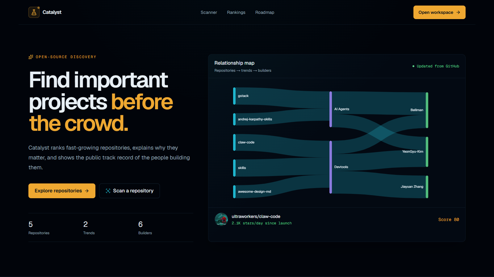

  

  <a href="https://github.com/Reinasboo">GitHub</a>
  &nbsp;&nbsp;·&nbsp;&nbsp;
  <a href="https://x.com/sharpmetaa">X</a>
  &nbsp;&nbsp;·&nbsp;&nbsp;
  <a href="https://x.com/sharpmetaa">Open to work & collaborations</a>

I’m **Spectrolite** — a product-focused software engineer with **4 years of
experience** building across onchain finance, AI, and developer tools. I enjoy
owning the whole problem, from system architecture and risk controls to the
details people interact with.

## Selected work

<table>
  <tr>
    <td width="50%" valign="top">
      
      <h3><a href="https://github.com/Reinasboo/catalyst">Catalyst</a></h3>
      
Find promising open-source projects before they become obvious. Catalyst weighs repository momentum, project quality, technical narratives, and builder history—and shows the evidence behind the signal.

      
<a href="https://github.com/Reinasboo/catalyst">Explore the source</a>

    </td>
    <td width="50%" valign="top">
      
      <h3><a href="https://github.com/Reinasboo/relayguard">RelayGuard</a></h3>
      
Payment infrastructure for merchants and software agents. Spending policies, human review, x402 payments, and settlement evidence bring control and accountability to stablecoin flows.

      
<a href="https://github.com/Reinasboo/relayguard">Explore the source</a>

    </td>
  </tr>
  <tr>
    <td width="50%" valign="top">
      
      <h3><a href="https://potonbase.vercel.app">POT</a></h3>
      
Group payments for trips, gifts, and shared goals. People agree on the goal, deadline, and refund rules up front—so everyone knows what they’re contributing to.

      
<a href="https://github.com/Reinasboo/pot">Explore the source</a>

    </td>
    <td width="50%" valign="top">
      
      <h3><a href="https://github.com/Reinasboo/poise">Poise</a></h3>
      
A private rehearsal companion for interviews, presentations, and speaking on camera. Camera-optional practice, local-first history, and grounded feedback put the person—not a score—at the center.

      
<a href="https://github.com/Reinasboo/poise">Explore the source</a>

    </td>
  </tr>
</table>

## More I’ve built

- **[HELD](https://heldevents.vercel.app)** — event reservations with refundable commitments, organizer check-in, and Solana escrow. <a href="https://github.com/Reinasboo/held">Source</a>
- **[Chorus](https://github.com/Reinasboo/chorus)** — collaborative finance and AI-assisted planning with human-controlled approvals.
- **[Agentic Wallet](https://github.com/Reinasboo/Agentic-wallet)** — intent-driven wallet orchestration and agent coordination on Solana.
- **[Market research and trading systems](https://github.com/Reinasboo/Spectrolite)** — market signals, analysis, and automated execution.
- **[SPARTAN](https://github.com/Reinasboo/SPARTAN)** — structured security-audit workflows for Web2 and Web3.

## Open-source contributions

<table>
  <tr>
    <td valign="top" width="30%">
      <h2>71</h2>
      
<strong>merged pull requests</strong>

      
Contributions to four upstream repositories in the Percolator ecosystem.

      
<a href="https://github.com/dcccrypto/percolator-launch">percolator-launch</a> · <a href="https://github.com/dcccrypto/percolator-stake">percolator-stake</a> · <a href="https://github.com/dcccrypto/percolator">percolator</a> · <a href="https://github.com/dcccrypto/percolator-keeper">percolator-keeper</a>

    </td>
    <td valign="top" width="70%">
      <strong>What those contributions cover</strong>
      <ul>
        <li><strong>Security and validation:</strong> <a href="https://github.com/dcccrypto/percolator-launch/pull/2045">Pyth oracle buffer bounds</a>, <a href="https://github.com/dcccrypto/percolator-launch/pull/1993">RPC origin validation</a>, and <a href="https://github.com/dcccrypto/percolator-launch/pull/2013">IP-bound market challenges</a>.</li>
        <li><strong>Abuse prevention:</strong> <a href="https://github.com/dcccrypto/percolator-launch/pull/2104">atomic Redis rate limiting</a> and safer devnet mint controls.</li>
        <li><strong>API reliability:</strong> <a href="https://github.com/dcccrypto/percolator-launch/pull/2105">metadata validation and request timeouts</a>, fail-closed handling for malformed data, and correct <a href="https://github.com/dcccrypto/percolator-launch/pull/2051">health-check status codes</a>.</li>
        <li><strong>Operational visibility:</strong> <a href="https://github.com/dcccrypto/percolator-launch/pull/2031">structured error logging</a> and rate-limit event reporting.</li>
      </ul>
    </td>
  </tr>
</table>

## Contributions in motion

The snake follows my live contribution grid. The animation refreshes automatically.

  <picture>
    <source media="(prefers-color-scheme: dark)" srcset="https://raw.githubusercontent.com/Reinasboo/reinasboo/output/github-contribution-grid-snake-dark.svg" />
    <source media="(prefers-color-scheme: light)" srcset="https://raw.githubusercontent.com/Reinasboo/reinasboo/output/github-contribution-grid-snake.svg" />
    
  </picture>

## Tools I work with

**Languages** · TypeScript · JavaScript · Python · Rust · Solidity 
**Product engineering** · React · Next.js · Node.js 
**Onchain** · Solana · Anchor · Base / EVM · NEAR 
**Data and infrastructure** · PostgreSQL · Supabase · SQLite · Redis 
**AI and research** · Agent workflows · LangGraph · PyTorch

I’m interested in products that make complex actions understandable: clear
permissions, reliable execution, evidence you can inspect, and interfaces that
help people stay in control.

## Open to work & collaborations

I’m open to product engineering roles and thoughtful collaborations—especially
with teams building onchain products, AI systems, or developer tools. Reach me
on [X](https://x.com/sharpmetaa) or through [GitHub](https://github.com/Reinasboo).
