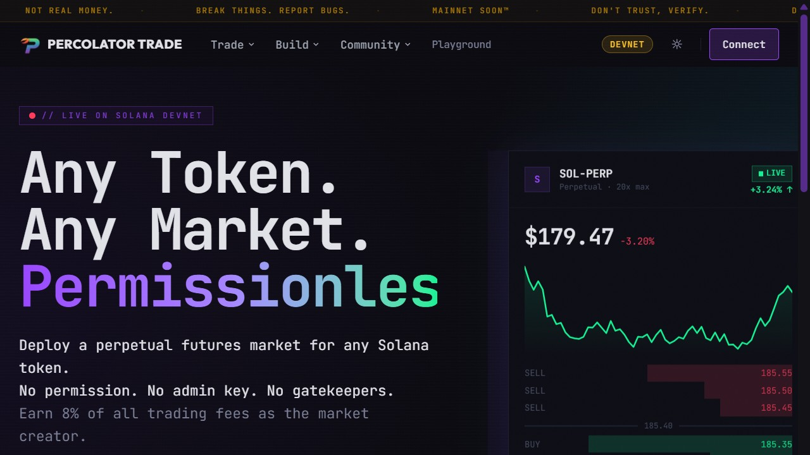
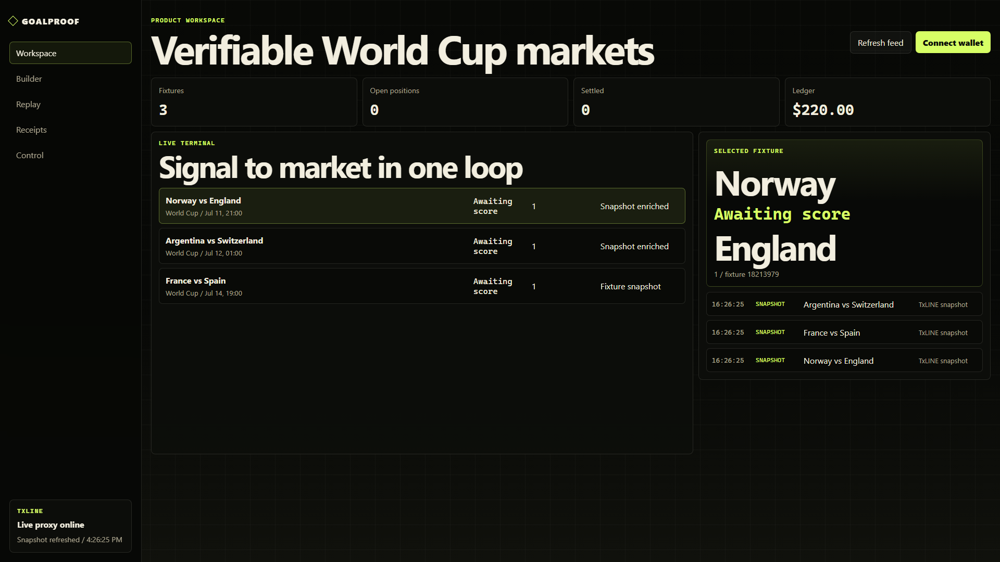

  <picture>
    <source media="(prefers-reduced-motion: reduce)" srcset="./assets/banner.svg" />
    
  </picture>

  
  &nbsp;&nbsp;
  
  &nbsp;&nbsp;·&nbsp;&nbsp;
  <a href="https://x.com/sharpmetaa">Open to work & collaborations</a>

I’m **Spectrolite** — a product designer and software engineer with **4 years of
experience** building across onchain finance, AI, market infrastructure, and
consumer products. I take products from problem framing and user flows through
visual systems, interaction details, and implementation—especially where trust,
risk, and complex states must feel clear.

## Percolator

<table>
  <tr>
    <td width="58%" valign="top">
      
    </td>
    <td width="42%" valign="top">
      <h3><a href="https://percolator.trade">Percolator</a></h3>
      
Permissionless perpetual markets on Solana. I’ve contributed upstream across its launcher, protocol, staking, and keeper repositories.

      
My work includes oracle safety, request validation, abuse prevention, API reliability, and operational visibility. The product challenge is making open market creation and risk legible without burying the mechanics.

      
<a href="https://percolator.trade">Visit the product</a> · <a href="https://percolator-launch.vercel.app">Deployed interface</a> · <a href="https://github.com/dcccrypto/percolator-launch">Launcher source</a>

    </td>
  </tr>
</table>

## Selected work

<table>
  <tr>
    <td width="50%" valign="top">
      
      <h3><a href="https://github.com/Reinasboo/catalyst">Catalyst</a></h3>
      
Find promising open-source projects before they become obvious. Catalyst weighs repository momentum, project quality, technical narratives, and builder history—and shows the evidence behind the signal.

      
<a href="https://github.com/Reinasboo/catalyst">Explore the source</a>

    </td>
    <td width="50%" valign="top">
      
      <h3><a href="https://github.com/Reinasboo/relayguard">RelayGuard</a></h3>
      
Payment infrastructure for merchants and software agents. Spending policies, human review, x402 payments, and settlement evidence bring control and accountability to stablecoin flows.

      
<a href="https://github.com/Reinasboo/relayguard">Explore the source</a>

    </td>
  </tr>
  <tr>
    <td width="50%" valign="top">
      
      <h3><a href="https://potonbase.vercel.app">POT</a></h3>
      
Group payments for trips, gifts, and shared goals. People agree on the goal, deadline, and refund rules up front—so everyone knows what they’re contributing to.

      
<a href="https://github.com/Reinasboo/pot">Explore the source</a>

    </td>
    <td width="50%" valign="top">
      
      <h3><a href="https://github.com/Reinasboo/poise">Poise</a></h3>
      
A private rehearsal companion for interviews, presentations, and speaking on camera. Camera-optional practice, local-first history, and grounded feedback put the person—not a score—at the center.

      
<a href="https://github.com/Reinasboo/poise">Explore the source</a>

    </td>
  </tr>
</table>

## More from the portfolio

<table>
  <tr>
    <td width="50%" valign="top">
      
      <h3><a href="https://github.com/Reinasboo/goalproof">GoalProof</a></h3>
      
Verifiable prediction markets on Solana. TxLINE fixture context, Anchor escrow, keeper settlement, and proof receipts connect each market to a clear resolution path.

    </td>
    <td width="50%" valign="top">
      
      <h3><a href="https://github.com/Reinasboo/momentum-league">Momentum League</a></h3>
      
A football matchday product with fixture-based fan rooms, predictions, standings, and a penalty-shootout game. Built with React, Vite, Express, and Solana sign-in.

    </td>
  </tr>
</table>

**Markets and onchain systems**

- **[Sentra Terminal](https://github.com/Reinasboo/sentra-terminal)** — Solana perpetuals analytics, market signals, and trader-focused research.
- **[Oracle Percolator](https://github.com/Reinasboo/oracle-percolator)** — multi-asset oracle intelligence with confidence, latency, spread, deviation, and anomaly telemetry.
- **[Smart Trader](https://github.com/Reinasboo/smart-trader)** — strategy-driven Solana market scanning and execution with explicit risk controls.
- **[TraderLite](https://github.com/Reinasboo/traderlite)** — Telegram-sourced trade monitoring, duplicate-buy safeguards, execution tracking, and a read-only PnL dashboard.
- **[Agentic Wallet](https://github.com/Reinasboo/Agentic-wallet)** — intent-driven wallet orchestration and multi-agent coordination on Solana.
- **[Spectrolite trading systems](https://github.com/Reinasboo/Spectrolite)** — market signals, analysis, and automated execution across Solana and EVM.
- **[Flash](https://github.com/Reinasboo/Flash)** — an agent wallet built for the Stellar ecosystem.

**Consumer products, community, and tools**

- **[HELD](https://heldevents.vercel.app)** — event reservations with refundable commitments, organizer check-in, and Solana escrow. <a href="https://github.com/Reinasboo/held">Source</a>
- **[Chorus](https://github.com/Reinasboo/chorus)** — collaborative finance and AI-assisted planning with human-controlled approvals.
- **[HolderProof](https://github.com/Reinasboo/holderproof)** — read-only wallet monitoring with a queue-backed event pipeline.
- **[Attention Market](https://github.com/Reinasboo/attention-market)** — transparent, deterministic scoring for emerging crypto narratives.
- **[DietMonitor](https://github.com/Reinasboo/dietmonitor)** — meal logging and pattern summaries.
- **[AMORA](https://github.com/Reinasboo/amora)** — a digital experience for a creative studio.
- **[SPARTAN](https://github.com/Reinasboo/SPARTAN)** — structured security-review workflows for web and onchain systems.

## Open-source contributions

Merged contributions across four upstream repositories in the Percolator
ecosystem: [percolator-launch](https://github.com/dcccrypto/percolator-launch),
[percolator-stake](https://github.com/dcccrypto/percolator-stake),
[percolator](https://github.com/dcccrypto/percolator), and
[percolator-keeper](https://github.com/dcccrypto/percolator-keeper).

- **Oracle safety:** [Pyth oracle buffer bounds](https://github.com/dcccrypto/percolator-launch/pull/2045), [RPC origin validation](https://github.com/dcccrypto/percolator-launch/pull/1993), and [IP-bound market challenges](https://github.com/dcccrypto/percolator-launch/pull/2013).
- **Abuse prevention:** [atomic Redis rate limiting](https://github.com/dcccrypto/percolator-launch/pull/2104) and safer devnet mint controls.
- **API reliability:** [metadata validation and request timeouts](https://github.com/dcccrypto/percolator-launch/pull/2105), fail-closed handling for malformed data, and correct [health-check status codes](https://github.com/dcccrypto/percolator-launch/pull/2051).
- **Operational visibility:** [structured error logging](https://github.com/dcccrypto/percolator-launch/pull/2031) and rate-limit event reporting.

## Design and engineering

**Product design** · Product framing · User journeys · Interaction design · Visual systems · Prototyping · Accessibility

**Languages and smart contracts**

  

**Product and data**

  

**Onchain, AI, and tooling**

  
  &nbsp;&nbsp;
  
  &nbsp;&nbsp;
  
  &nbsp;&nbsp;
  
  &nbsp;&nbsp;
  
  &nbsp;&nbsp;
  
  &nbsp;&nbsp;
  

Anchor · Base / EVM · LangGraph

I’m interested in products that make complex actions understandable: clear
permissions, reliable execution, evidence you can inspect, and interfaces that
help people stay in control.

## Open to work & collaborations

I’m open to product engineering roles and thoughtful collaborations—especially
with teams building onchain products, AI systems, or developer tools. Reach me
through the GitHub and X icons at the top of this profile.
